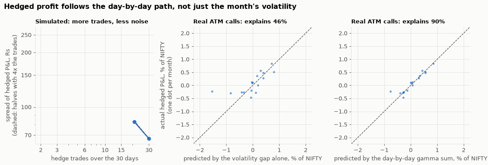
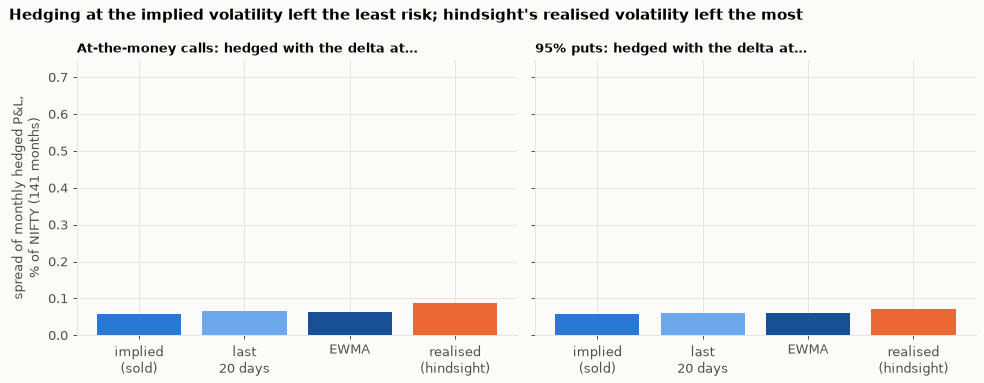

# Delta Hedging Simulator

[](https://github.com/Dhirajdas18/delta-hedging-simulator/actions/workflows/ci.yml)
[](https://dhirajdas18.github.io/delta-hedging-simulator/)

Sell an option, hedge it with NIFTY futures, and study what is left: why the hedged P&L depends on
the path the market takes, which volatility to hedge at, how often to rebalance after Indian trading
costs, and what overnight gaps do to a hedge.

**Live hedging simulator: [dhirajdas18.github.io/delta-hedging-simulator](https://dhirajdas18.github.io/delta-hedging-simulator/)**,
set the NIFTY level, strike, days, the volatility you sold at, the volatility that actually
happens and the one you hedge at, the rebalancing rule, costs and jumps, and see the spread of
hedged P&L against the bare short, how well the gamma formula explains each path, and sample
hedges; all computed in the browser.

## Features

- [x] Why hedged P&L depends on the path: gamma times the gap between implied and realised variance
- [x] Which volatility to hedge at: implied, realised or a forecast
- [ ] When to rebalance: fixed times against delta bands, after Indian trading costs
- [ ] What the close can't hedge: overnight gaps and jumps
- [ ] Gamma hedging with a second option
- [ ] Hedging single-stock options against NIFTY
- [ ] Is selling and hedging options an edge after costs and gaps

## Findings

### 1. Hedged profit followed the day-by-day path, not just the month's volatility

<a href="docs/img/path.png"><picture><source media="(prefers-reduced-motion: reduce)" srcset="docs/img/path.png"></picture></a>

A seller who delta-hedges earns, each day, half of gamma times the forward squared times the gap
between the variance sold (σ²Δt) and the day's squared move. Days near the strike, where gamma is
high, count most, so two months with the same realised volatility can end differently. In simulation,
a 30-day at-the-money call (worth ₹427) is sold at the volatility that then happens (15%) and hedged
every 1 to 15 days. On real data, at each month-end from January 2015 to October 2026 (141), the
monthly at-the-money call and the 95% put are sold at their SVI implied volatility (from
implied-vol-surface's local data) and hedged at every close with that expiry's futures until expiry
(median 18 trading days), with the delta at the sold volatility and NIFTY's close settling the
option. Each month's hedged P&L is set against two predictions: the volatility gap (the option's
price at the sold volatility minus at the month's realised volatility) and the day-by-day gamma sum.

- **More trades, less noise, at the square-root rate.** The spread of simulated hedged P&L fell
  from ₹240 with a trade every 15 days to ₹67 with daily trades, in proportion to one over the
  square root of the number of trades (fitted power −0.47; theory −0.5). Unhedged, it was ₹650.
- **The path explained most of each real month.** For the at-the-money calls, the gamma sum
  explained 85% of the month-to-month variation in hedged P&L and the volatility gap 41%; for the
  95% puts, 88% and 56%.
- **The right volatility call could still lose.** Implied volatility was above the month's
  realised in 70% of the call months, yet 12 of those months (12%) lost money after hedging; in 8 of
  the 43 months with implied below realised the hedged call still made money. For puts, 11 of 124
  and 2 of 17.
- **Hedging cut the spread four- to five-fold.** Hedged, the call's P&L averaged +0.12% of
  NIFTY a month with a spread of 0.48%, against a 2.60% spread unhedged; the put +0.07% with 0.47%
  against 1.70%.

### 2. Hedging at the implied volatility left the least risk; knowing the realised volatility didn't help

<a href="docs/img/hedge_vol.png"><picture><source media="(prefers-reduced-motion: reduce)" srcset="docs/img/hedge_vol.png"></picture></a>

Finding 1's months again: each option is sold at its implied volatility, and only the delta used to
hedge changes. The delta is computed at the implied volatility the option was sold at; at NIFTY's
volatility over the last 20 trading days; at EWMA volatility (λ 0.94), both known at the start; or
at the month's realised volatility, which is known only afterwards. Nothing is fitted, so every
month is out of sample. A simulation (30-day at-the-money call sold at 15%, hedged daily) checks
hedging at the true volatility when it stays at 13% and when it runs at 8% then 18%.

- **The implied volatility gave the steadiest result.** Monthly hedged P&L had a spread of 0.48% of
  NIFTY for at-the-money calls with the implied volatility, 0.53% with either trailing volatility and
  0.71% with the realised; for 95% puts, 0.47%, 0.49%, 0.49% and 0.57%.
- **Hindsight didn't help, even in simulation.** With volatility constant at 13%, hedging at the
  true 13% left a spread of ₹58.5 against ₹61.8 at 15%; when it ran at 8% then 18%, hedging at the
  month's average left more, ₹84.0 against ₹79.8.
- **The halves mostly agreed.** For calls the implied volatility gave the smallest spread in both
  2015–2020 (0.56% against 0.90% for the realised) and 2021–2026 (0.40% against 0.44%). For puts in
  2021–2026 the realised was slightly smaller (0.33% against 0.36%).
- **A lower hedge volatility raised the puts' average.** The 95% put sold at a median 16.8% averaged
  +0.067% of NIFTY a month hedged at that volatility and +0.090% to +0.118% hedged at the lower
  trailing or realised volatilities (medians 12.1%–12.7%), with a wider spread.

## Quick start

```bash
uv sync
uv run dhs report <topic>               # a study's numbers and charts -> out/
                                        # (topics: path, hedge-vol)
uv run python scripts/build_site.py     # hedging simulator -> site/index.html (code only, no data)
uv run pytest
```

The simulator and the tests need no market data; the tests of the browser maths need Node.

## Design

- `src/dhs/real.py`: real NIFTY months from implied-vol-surface's local data (`DHS_IV_DIR`) and
  NIFTY's close from the NSE bhavcopy archive (`DHS_LAKE_DIR` or `IV_LAKE_DIR`): sell at the SVI
  volatility at the strike, hedge at every close with the expiry's futures, and the volatility-gap
  and gamma-sum predictions, with the delta at the sold, trailing or realised volatility. Nothing from
  NSE is committed.
- `src/dhs/sim.py`: the core maths in numpy (scipy only for the normal CDF): Black-76 price,
  delta, gamma and vega on a forward; forward paths as geometric Brownian motion with drift
  −σ²/2 in logs, with optional Merton jumps compensated so the forward stays a martingale; and
  `hedge_pnl`, which sells one option at one volatility, hedges it with futures at Black-76 delta
  at another, rebalancing on a fixed schedule or when delta drifts outside a band, with costs as
  a percentage of the traded value plus a fixed amount per trade. It returns each path's hedged
  P&L, trades, costs, the bare short's P&L and the gamma formula's prediction,
  Σ ½ΓF²(σ²Δt − (ΔF/F)²) plus the premium gap.
- `src/dhs/sim.js`: the simulator's browser copy of Black-76, the seeded paths (mulberry32 with
  Box-Muller) and `hedgePnl`, tested against Python through Node: same seed, same paths, P&L equal
  to 1e-9.
- `src/dhs/reports.py`: README findings, reproducible with `dhs report <topic>`.
- `src/dhs/site.py`: the hedging simulator, one static Plotly page built from code alone.
- `src/dhs/plots.py`: the shared chart style and the animated README charts.
- Conventions: time to expiry is calendar days / 365; rates are continuously compounded, a year;
  money is in rupees per unit of NIFTY and valued at expiry; the premium sits in cash earning the
  rate and futures need no money up front.
- Data: NSE's daily F&O bhavcopy through implied-vol-surface's local data (NIFTY option closing
  prices, forwards and SVI fits) and NIFTY's close from the NSE bhavcopy archive; read locally, never
  committed. The page needs no data.
- Charts: one validated palette; README charts are animated GIFs with a static fallback for
  reduced-motion users.

Research only, not investment advice. MIT licence.
