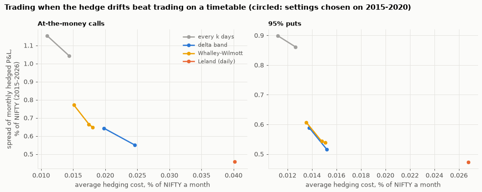
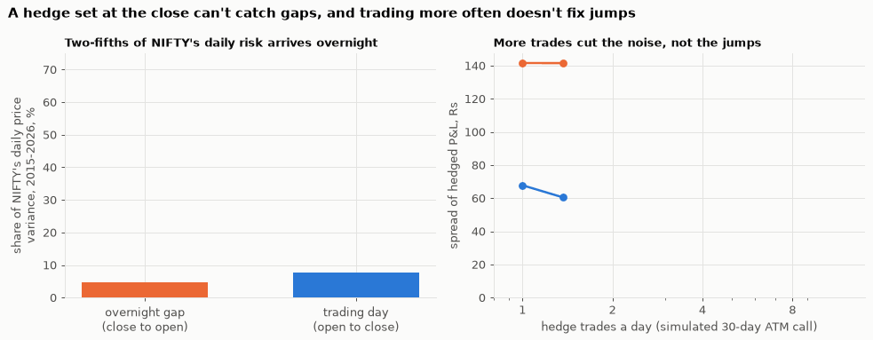
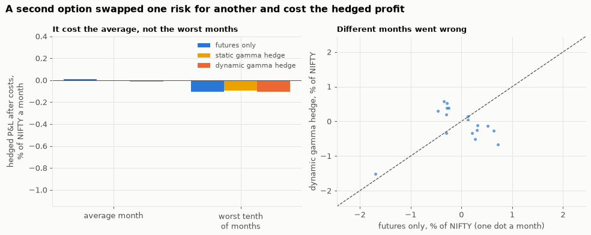
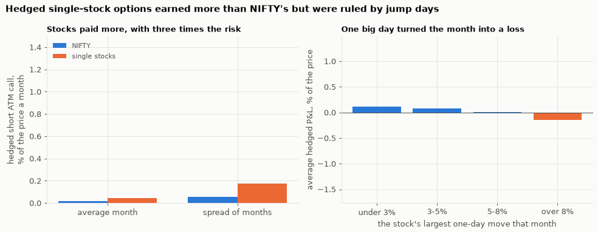
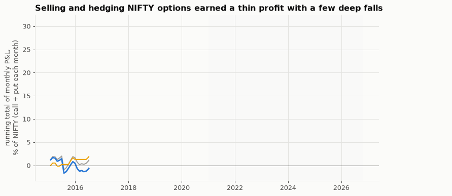

# Delta Hedging Simulator

[](https://github.com/Dhirajdas18/delta-hedging-simulator/actions/workflows/ci.yml)
[](https://dhirajdas18.github.io/delta-hedging-simulator/)

Sell an option, hedge it with NIFTY futures, and study what is left: why the hedged P&L depends on
the path the market takes, which volatility to hedge at, how often to rebalance after Indian trading
costs, and what overnight gaps do to a hedge.

**Live hedging simulator: [dhirajdas18.github.io/delta-hedging-simulator](https://dhirajdas18.github.io/delta-hedging-simulator/)**,
set the NIFTY level, strike, days, the volatility you sold at, the volatility that actually
happens and the one you hedge at, the rebalancing rule, costs and jumps, and see the spread of
hedged P&L against the bare short, how well the gamma formula explains each path, and sample
hedges; all computed in the browser.

## Features

- [x] Why hedged P&L depends on the path: gamma times the gap between implied and realised variance
- [x] Which volatility to hedge at: implied, realised or a forecast
- [x] When to rebalance: fixed times against delta bands, after Indian trading costs
- [x] What the close can't hedge: overnight gaps and jumps
- [x] Gamma hedging with a second option
- [x] Hedging single-stock options against NIFTY
- [x] Is selling and hedging options an edge after costs and gaps

## Findings

### 1. Hedged profit followed the day-by-day path, not just the month's volatility

<a href="docs/img/path.png"><picture><source media="(prefers-reduced-motion: reduce)" srcset="docs/img/path.png"></picture></a>

A seller who delta-hedges earns, each day, half of gamma times the forward squared times the gap
between the variance sold (σ²Δt) and the day's squared move. Days near the strike, where gamma is
high, count most, so two months with the same realised volatility can end differently. In simulation,
a 30-day at-the-money call (worth ₹427) is sold at the volatility that then happens (15%) and hedged
every 1 to 15 days. On real data, at each month-end from January 2015 to October 2026 (141), the
monthly at-the-money call and the 95% put are sold at their SVI implied volatility (from
implied-vol-surface's local data) and hedged at every close with that expiry's futures until expiry
(median 18 trading days), with the delta at the sold volatility and NIFTY's close settling the
option. Each month's hedged P&L is set against two predictions: the volatility gap (the option's
price at the sold volatility minus at the month's realised volatility) and the day-by-day gamma sum.

- **More trades, less noise, at the square-root rate.** The spread of simulated hedged P&L fell
  from ₹240 with a trade every 15 days to ₹67 with daily trades, in proportion to one over the
  square root of the number of trades (fitted power −0.47; theory −0.5). Unhedged, it was ₹650.
- **The path explained most of each real month.** For the at-the-money calls, the gamma sum
  explained 85% of the month-to-month variation in hedged P&L and the volatility gap 41%; for the
  95% puts, 88% and 56%.
- **The right volatility call could still lose.** Implied volatility was above the month's
  realised in 70% of the call months, yet 12 of those months (12%) lost money after hedging; in 8 of
  the 43 months with implied below realised the hedged call still made money. For puts, 11 of 124
  and 2 of 17.
- **Hedging cut the spread four- to five-fold.** Hedged, the call's P&L averaged +0.12% of
  NIFTY a month with a spread of 0.48%, against a 2.60% spread unhedged; the put +0.07% with 0.47%
  against 1.70%.

### 2. Hedging at the implied volatility left the least risk; knowing the realised volatility didn't help

<a href="docs/img/hedge_vol.png"><picture><source media="(prefers-reduced-motion: reduce)" srcset="docs/img/hedge_vol.png"></picture></a>

Finding 1's months again: each option is sold at its implied volatility, and only the delta used to
hedge changes. The delta is computed at the implied volatility the option was sold at; at NIFTY's
volatility over the last 20 trading days; at EWMA volatility (λ 0.94), both known at the start; or
at the month's realised volatility, which is known only afterwards. Nothing is fitted, so every
month is out of sample. A simulation (30-day at-the-money call sold at 15%, hedged daily) checks
hedging at the true volatility when it stays at 13% and when it runs at 8% then 18%.

- **The implied volatility gave the steadiest result.** Monthly hedged P&L had a spread of 0.48% of
  NIFTY for at-the-money calls with the implied volatility, 0.53% with either trailing volatility and
  0.71% with the realised; for 95% puts, 0.47%, 0.49%, 0.49% and 0.57%.
- **Hindsight didn't help, even in simulation.** With volatility constant at 13%, hedging at the
  true 13% left a spread of ₹58.5 against ₹61.8 at 15%; when it ran at 8% then 18%, hedging at the
  month's average left more, ₹84.0 against ₹79.8.
- **The halves mostly agreed.** For calls the implied volatility gave the smallest spread in both
  2015–2020 (0.56% against 0.90% for the realised) and 2021–2026 (0.40% against 0.44%). For puts in
  2021–2026 the realised was slightly smaller (0.33% against 0.36%).
- **A lower hedge volatility raised the puts' average.** The 95% put sold at a median 16.8% averaged
  +0.067% of NIFTY a month hedged at that volatility and +0.090% to +0.118% hedged at the lower
  trailing or realised volatilities (medians 12.1%–12.7%), with a wider spread.

### 3. Trading when the hedge drifts beat trading on a timetable, but saved only a little against daily hedging

<a href="docs/img/rebalance.png"><picture><source media="(prefers-reduced-motion: reduce)" srcset="docs/img/rebalance.png"></picture></a>

Finding 1's months are hedged again at the daily closes, now paying for every futures trade at
today's Indian rates (from 1 April 2026, applied to every year): STT 0.05% of the sale value, NSE
and SEBI charges, stamp duty on purchases, ₹20 brokerage an order and GST, for a book of 10 lots
(650 units of NIFTY); no lot rounding and no bid-ask spread. Four kinds of rule decide when to
trade: every k trading days; whenever the hedge has drifted from the target delta by more than a
band; a Whalley-Wilmott band, which widens with costs and narrows with gamma, trading only to its
edge; and Leland's daily hedge with a cost-raised volatility. Each rule's setting is the cheapest
one whose 2015–2020 spread of monthly hedged P&L is no wider than daily hedging's (or the closest
if none is), and is then scored on 2021–2026.

- **Daily hedging cost about 0.04% of NIFTY a month.** For the at-the-money call, 0.0405% in
  2015–2020 and 0.0363% in 2021–2026 (18 trades a month); for the 95% put, 0.029% and 0.022%.
- **Bands beat timetables.** In 2015–2020 a band of 0.05 delta left a spread of 0.575% of NIFTY for
  0.034% of cost; trading every second day left 0.831% for 0.029%. For puts, 0.605% against 0.671%
  at the same cost.
- **Against daily hedging the saving was small.** Out of sample, the chosen delta band cut the
  call's hedging cost by 7.4% (0.034% against 0.036% of NIFTY) with the same spread; Whalley-Wilmott
  cut it by 13.4% for a 2.2% wider spread; for puts, by 7.9% and 11.6% (the latter with a 2.3%
  narrower spread). Leland's volatility changed almost nothing (cost −1.2% calls, +1.0% puts).
- **Costs took about a quarter of the hedged profit.** In 2021–2026 daily hedging costs took the
  call's +0.135% of NIFTY a month (finding 2) to +0.099%, and the put's +0.079% to +0.057%.

### 4. Two-fifths of NIFTY's daily risk arrived overnight, and hedging more often didn't fix jumps

<a href="docs/img/gaps.png"><picture><source media="(prefers-reduced-motion: reduce)" srcset="docs/img/gaps.png"></picture></a>

A hedge set at each close is exposed to the jump from that close to the next morning's open, and
no trading during the day can remove it. NIFTY's daily open and close from the NSE bhavcopy archive
(2,926 days, January 2015 to November 2026) split each close-to-close move into the overnight gap
and the trading-day move. Finding 1's months are then hedged at each close and, separately, at each
open as well (the futures' open isn't in the data, so the forward is assumed to gap by the same
proportion as the index; 132 months with every open and close). A simulation of a 30-day
at-the-money call hedged 1, 2, 4 or 8 times a day, with and without jumps (4 a year, average −2%,
spread 3%), shows what more trading can and can't do.

- **The gap carried about two-fifths of the risk.** Overnight gaps were 39.9% of NIFTY's
  close-to-close variance and the trading day 65.5%, partly cancelling (correlation −0.04, cross term
  −5.4%); weighted by each day's gamma, gaps were 44–45% of the months' squared moves.
- **A few gaps carried a fifth.** The biggest 1% of gaps (30 days) carried 21.7% of all close-to-close
  variance; the largest were −9.6% on 23 March 2020, −5.7% on 9 November 2016, −5.2% on 13 March 2020
  and −5.1% on 7 April 2025.
- **Hedging at the open as well didn't help reliably.** The call's monthly spread went from 0.487%
  to 0.500% of NIFTY and the put's from 0.474% to 0.448%; both averages fell (call +0.111% to +0.052%,
  put +0.050% to +0.033%).
- **More trades cut the noise, not the jumps.** In simulation without jumps the spread fell from ₹68
  with one hedge a day to ₹34 with four and ₹24 with eight; with jumps it stayed at ₹142, ₹131 and ₹130.

### 5. A second option swapped one risk for another and cost the hedged profit

<a href="docs/img/gamma.png"><picture><source media="(prefers-reduced-motion: reduce)" srcset="docs/img/gamma.png"></picture></a>

Finding 1's short at-the-money calls (140 months) are hedged three ways: futures only; a static
gamma hedge, buying enough of the next monthly expiry's call at the same strike to cancel the
gamma at the start and holding it; and a dynamic one, re-setting that amount at every close. The
back-month call is priced each day from its own SVI smile and sold on the front expiry. Every trade
pays today's Indian costs (futures as in finding 3; options STT 0.15% on sales, NSE, SEBI, stamp, GST
and ₹20 an order) and half of an assumed 1-point option bid-ask spread. The hedge ratio is set by
the two gammas, so nothing is fitted.

- **The gamma hedge cost the average.** After costs, futures-only hedging made +0.086% of NIFTY a
  month, the static gamma hedge +0.004% and the dynamic one −0.095% (costs 0.038%, 0.051% and 0.105%
  a month).
- **It didn't make the bad months better on average.** The worst tenth of months averaged −0.86% with
  futures only, −0.75% static and −0.88% dynamic; the spread was 0.488%, 0.588% and 0.459%.
- **It rescued the futures hedge's worst months but lost in others.** August 2019 went from −2.27%
  with futures only to +0.01% static; February 2020, the month into the crash, from −1.11% to +5.04%
  static and +2.07% dynamic. But monthly results with and without the dynamic gamma hedge had a
  correlation of −0.32: the gamma-hedged book lost in different months, most in the month from the
  end of March 2020 (−2.24%, when futures only made +1.95%).

### 6. Hedged single-stock options earned more than NIFTY's, with three times the risk, and were ruled by jump days

<a href="docs/img/stocks.png"><picture><source media="(prefers-reduced-motion: reduce)" srcset="docs/img/stocks.png"></picture></a>

At each month-end, every F&O stock's monthly expiry 15–45 days out gives a forward (the stock
future's settlement price) and an at-the-money strike (the one nearest it with a traded call and
put); the call is sold at the mean of their implied volatilities and hedged at every close with the
stock's split-adjusted price, scaled to the forward, until expiry (carry over the month ignored).
Option symbols are mapped to the company's current symbol before prices are looked up. That gives
24,390 stock-months on 141 month-ends (349 stocks), set against finding 1's NIFTY calls; grouping
months by their largest one-day move is done after the fact, to see what drove the result.

- **Stocks paid more per month.** Sold at a median 33.0% volatility (NIFTY 14.0%), 1.16 times what
  followed, the hedged stock call made +0.37% of the price a month (2015–2020 +0.43%, 2021–2026
  +0.33%) against +0.12% for NIFTY.
- **With three times the risk.** The monthly spread was 1.42% against 0.48%, so the return per unit
  of spread was about the same (0.26 against 0.25); a third of months lost money in both.
- **One big day decided the month.** In the 10% of stock-months with a one-day move over 8% the
  hedged call lost −1.17% on average; with the largest move under 3% it made +0.99%. The day-by-day
  gamma formula explained 68% of the stocks' monthly results, against 85% for NIFTY.

### 7. Selling and hedging NIFTY options earned a thin profit after costs, with falls worth five years of it

<a href="docs/img/verdict.png"><picture><source media="(prefers-reduced-motion: reduce)" srcset="docs/img/verdict.png"></picture></a>

The findings put together: at each month-end from January 2015 to October 2026 (141), sell one
at-the-money call and one 95% put at their implied volatility, hedge each with futures on finding 3's
delta band (settings chosen on 2015–2020), and pay every Indian cost on the futures and on selling
the options, plus half of an assumed 1-point option spread. Results are per unit of NIFTY, as % of the
forward, so they are a return on the notional, not on the margin a broker would hold. 2021–2026 is
out of sample for the band settings. One rule fixed in advance is also tried: sell only when the
sold volatility is above NIFTY's last-20-day volatility.

- **Before costs there was an edge.** The book made +0.186% of NIFTY a month (+2.24% a year), positive
  in 74% of months, t 2.64.
- **Costs took about two-fifths.** Futures hedging cost 0.059% a month and selling the options 0.012%;
  after costs the book made +0.116% a month (+1.39% a year), t 1.62, positive in 71% of months. In
  2021–2026 alone, +0.145% (t 1.78).
- **A few months took years of it back.** The worst were −4.10% (February 2020, into the crash),
  −3.11% (July 2015) and −2.96% (August 2019); the deepest fall in the running total was −6.77%, 4.9
  years of the average profit.
- **Waiting for rich volatility didn't help out of sample.** Selling only in the 68% of months when
  implied was above recent volatility made +0.167% a month over all years (t 2.31) and cut the worst
  fall to −4.69%, but its gain came in 2015–2020; in 2021–2026 it made +0.155% against +0.145%.

## Quick start

```bash
uv sync
uv run dhs report <topic>               # a study's numbers and charts -> out/
                                        # (topics: path, hedge-vol, rebalance, gaps,
                                        #  gamma, stocks, verdict)
uv run python scripts/build_site.py     # hedging simulator -> site/index.html (code only, no data)
uv run pytest
```

The simulator and the tests need no market data; the tests of the browser maths need Node.

## Design

- `src/dhs/real.py`: real NIFTY months from implied-vol-surface's local data (`DHS_IV_DIR`) and
  NIFTY's close from the NSE bhavcopy archive (`DHS_LAKE_DIR` or `IV_LAKE_DIR`): sell at the SVI
  volatility at the strike, hedge at every close with the expiry's futures, and the volatility-gap
  and gamma-sum predictions, with the delta at the sold, trailing or realised volatility. Nothing from
  NSE is committed.
- `src/dhs/rebalance.py`: NIFTY futures costs at today's Indian rates and the time, delta-band,
  Whalley-Wilmott and Leland rebalancing rules on real month paths.
- `src/dhs/gaps.py`: NIFTY's open and close from the NSE bhavcopy archive's index files, the
  overnight-gap split of each month's moves, and the hedge rebalanced at the open as well as the close.
- `src/dhs/gamma.py`: the short call hedged with futures only or with the next monthly expiry's
  call (static or re-set daily), back option priced from its own smile, Indian futures and option
  costs and a 1-point option spread.
- `src/dhs/stocks.py`: at-the-money implied volatility of every F&O stock at month-ends from the
  option and futures closes, current-symbol mapping, and the monthly sold-and-hedged calls on
  split-adjusted prices.
- `src/dhs/verdict.py`: the combined book (call and put sold each month, band-hedged, all costs),
  the rich-volatility rule, and summary statistics.
- `src/dhs/sim.py`: the core maths in numpy (scipy only for the normal CDF): Black-76 price,
  delta, gamma and vega on a forward; forward paths as geometric Brownian motion with drift
  −σ²/2 in logs, with optional Merton jumps compensated so the forward stays a martingale; and
  `hedge_pnl`, which sells one option at one volatility, hedges it with futures at Black-76 delta
  at another, rebalancing on a fixed schedule or when delta drifts outside a band, with costs as
  a percentage of the traded value plus a fixed amount per trade. It returns each path's hedged
  P&L, trades, costs, the bare short's P&L and the gamma formula's prediction,
  Σ ½ΓF²(σ²Δt − (ΔF/F)²) plus the premium gap.
- `src/dhs/sim.js`: the simulator's browser copy of Black-76, the seeded paths (mulberry32 with
  Box-Muller) and `hedgePnl`, tested against Python through Node: same seed, same paths, P&L equal
  to 1e-9.
- `src/dhs/reports.py`: README findings, reproducible with `dhs report <topic>`.
- `src/dhs/site.py`: the hedging simulator, one static Plotly page built from code alone.
- `src/dhs/plots.py`: the shared chart style and the animated README charts.
- Conventions: time to expiry is calendar days / 365; rates are continuously compounded, a year;
  money is in rupees per unit of NIFTY and valued at expiry; the premium sits in cash earning the
  rate and futures need no money up front.
- Data: NSE's daily F&O bhavcopy through implied-vol-surface's local data (NIFTY option closing
  prices, forwards and SVI fits) and NIFTY's close from the NSE bhavcopy archive; read locally, never
  committed. The page needs no data.
- Charts: one validated palette; README charts are animated GIFs with a static fallback for
  reduced-motion users.

Research only, not investment advice. MIT licence.
